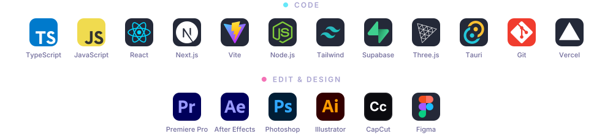

  

  &nbsp;
  &nbsp;
  

 

  Hey, I'm Furkan 👋 I edit videos and build things on the web. 
  You'll find my edits on <a href="https://www.instagram.com/seeok.edits/">@seeok.edits</a>, and my side projects right here. 
  Right now I'm working on <a href="https://studymode.fun"><b>studymode.fun</b></a>.

 

<h3 align="center">Projects</h3>

  
  

 

<h3 align="center">Toolbox</h3>

  

 

<h3 align="center">Activity</h3>

  <picture>
    <source media="(prefers-color-scheme: dark)" srcset="https://raw.githubusercontent.com/justfurkann/justfurkann/output/github-snake-dark.svg" />
    <source media="(prefers-color-scheme: light)" srcset="https://raw.githubusercontent.com/justfurkann/justfurkann/output/github-snake.svg" />
    
  </picture>

